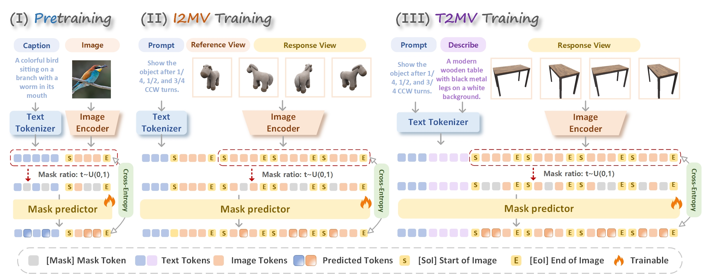

# [ICML 2026] Multi-View Consistent Image Generation via Multimodal Discrete Diffusion Models

Official implementation of [Multi-View Consistent Image Generation via Multimodal Discrete Diffusion Models](https://arxiv.org/abs/2512.14099).



<a href="https://arxiv.org/pdf/2512.14099"></a>


## Installation

```bash
conda env create -f environment.yml
conda activate viewmask
```

Before running the code, create `configs/paths.env` using `configs/paths.env.example` as a template, and update the model, checkpoint, and dataset paths to match your local setup. Relative paths are resolved from the repository root.

Use a LLaDA checkpoint with a visual vocabulary for pretraining and a MAGVITv2 visual tokenizer. Stage 1 appends missing visual and task tokens without changing existing token IDs. Later stages require a tokenizer matching the checkpoint vocabulary. If a checkpoint does not include tokenizer files, set `INFERENCE_TOKENIZER` separately.

## Training

| Stage | Entry point | Data |
| --- | --- | --- |
| Pretraining | `scripts/train_stage1_pretrain.py` | ImageNet, LLaVA |
| i2mv | `scripts/train_stage2_i2mv.py` | Objaverse, HSSD |
| t2mv | `scripts/train_stage3_t2mv.py` | Objaverse captions, HSSD |

```bash
ENV_FILE=configs/paths.env bash scripts/stage1_pretrain.sh
ENV_FILE=configs/paths.env bash scripts/stage2_i2mv.sh
ENV_FILE=configs/paths.env bash scripts/stage3_t2mv.sh
```

Each stage exports a model and tokenizer. Set `STAGE1_CHECKPOINT` and `STAGE2_CHECKPOINT` to the preceding stage outputs. Use `--load_from_checkpoint` to initialize weights, or `--resume` / `--resume_from_checkpoint` to restore training state.

For distributed training, set `NUM_MACHINES`, `NUM_PROCESSES` (total GPUs), `MASTER_ADDR`, and a distinct `FORCE_RANK` on each node. The launcher uses DeepSpeed ZeRO-2 with CPU optimizer offload and bf16. Dataset workers must remain at zero because images are encoded on the training GPU. Set `GSO_EVAL_JSON` to enable periodic generation evaluation.

## Inference

Before running inference, download the following models and place their files in the corresponding directories:

| Model | Download | Local directory |
| --- | --- | --- |
| ViewMask checkpoint and text tokenizer | [zhuruishu/ViewMask-1-to-3](https://huggingface.co/zhuruishu/ViewMask-1-to-3) | `checkpoints/viewmask1-to-3/` |
| MAGVITv2 visual tokenizer | [showlab/magvitv2](https://huggingface.co/showlab/magvitv2) | `checkpoints/magvitv2/` |

These are the default inference paths. For different locations, pass `--model_path` and `--magvit_path` to the inference command.

Run the following commands from the repository root. For i2mv, `--question` is optional and defaults to a GSO instruction for 90, 180, and 270 degree counterclockwise views. For t2mv, `--question` must describe the object.

```bash
python -m scripts.inference_mv --mode i2mv \
  --image_path assets/gso/3D_Dollhouse_Sofa.png \
  --output_dir outputs/demo_i2mv

python -m scripts.inference_mv --mode t2mv \
  --question 'Silver car with black trim and wheels, featuring a panoramic sunroof and LED taillights.' \
  --output_dir outputs/demo_t2mv
```

## GSO evaluation

```bash
ENV_FILE=configs/paths.env bash scripts/eval_gso.sh
```

## Acknowledgments

We sincerely thank the authors and contributors of [LLaDA](https://github.com/ML-GSAI/LLaDA), [MAGVITv2](https://magvit.cs.cmu.edu/v2/), [Hugging Face Transformers](https://github.com/huggingface/transformers) for their excellent work. ViewMask-1-to-3 is built on top of these projects.